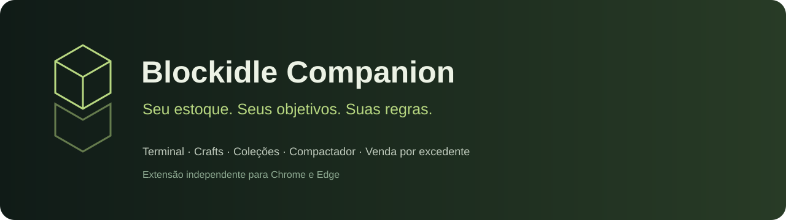
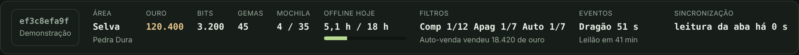
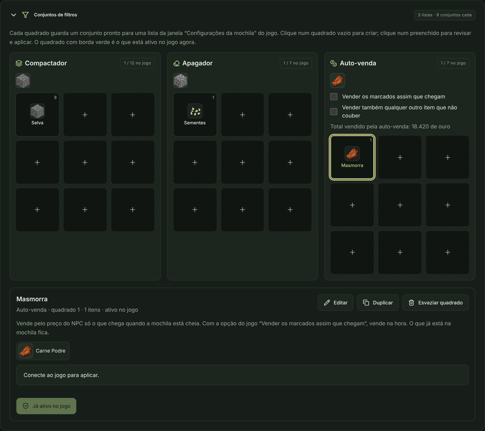
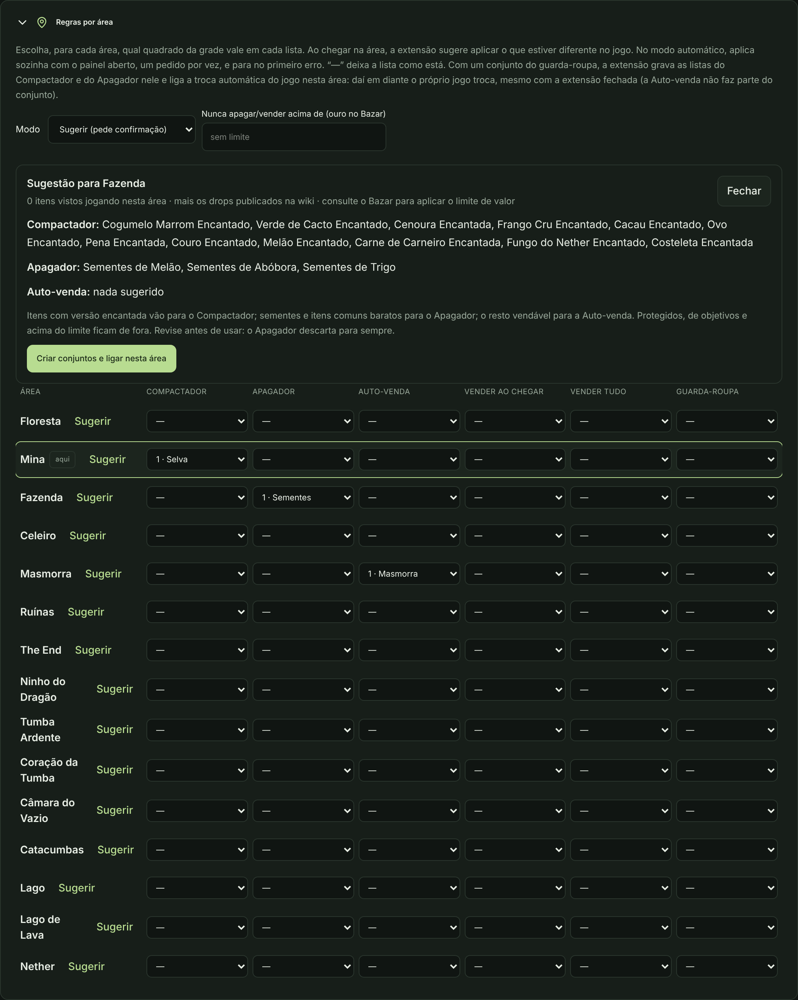
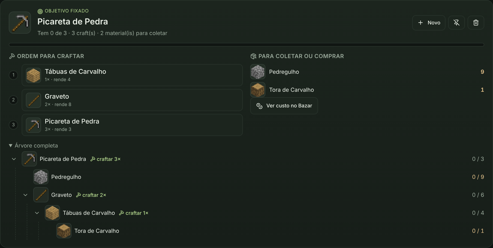
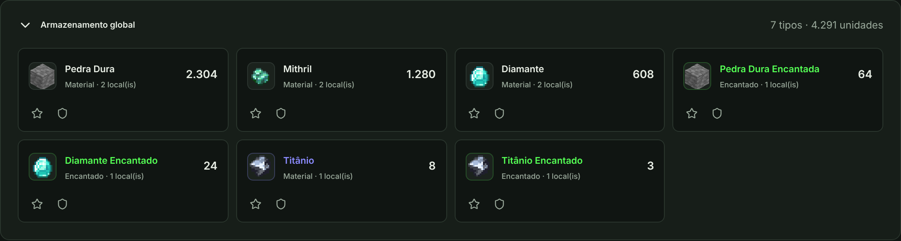
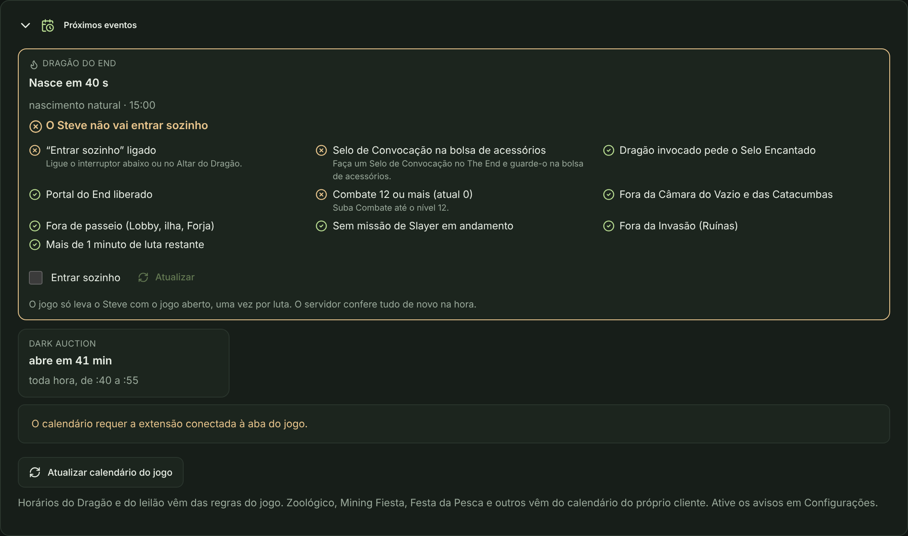
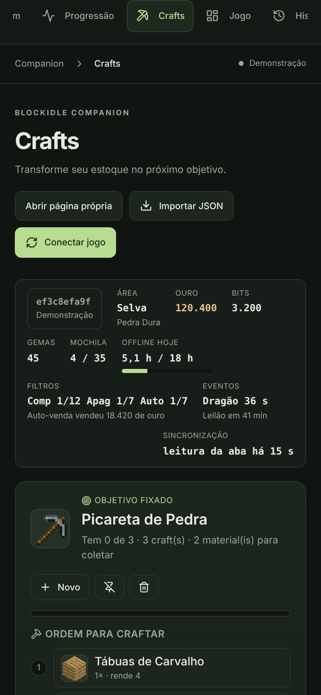

**Organize recursos, planeje crafts e acompanhe sua evolução no Blockidle em um só painel.**

[Baixar extensão](https://github.com/felippesantinifernandes-sketch/blockidle-companion/releases/latest) · [Como instalar](INSTALACAO.md) · [Novidades](CHANGELOG.md) · [Reportar problema](https://github.com/felippesantinifernandes-sketch/blockidle-companion/issues/new)

## Instalar

1. Em [Releases](https://github.com/felippesantinifernandes-sketch/blockidle-companion/releases/latest), baixe o arquivo que termina em **`-INSTALAR.zip`**. O `codigo-fonte-NAO-INSTALAR.zip` e o botão verde “Code” não são a extensão.
2. Extraia numa pasta que você não vai apagar.
3. Abra `chrome://extensions` (ou `edge://extensions`) e ligue o **Modo do desenvolvedor**.
4. Clique em **Carregar sem compactação** e escolha a pasta que tem o arquivo `manifest.json`.
5. Abra o Blockidle e clique no ícone da extensão para abrir o painel.

**Já usa a extensão?** Atualize pela central em **Configurações** escolhendo a mesma pasta instalada. Não desinstale: a mesma instalação guarda suas preferências. [Instruções completas](INSTALACAO.md)

## Barra de status

No topo de todas as guias: build do jogo e compatibilidade, área e tarefa atual, ouro, Bits, Gemas, mochila, tempo offline do dia, quantos filtros estão ativos, total da auto-venda e os próximos eventos. Os dados são relidos do jogo a cada 5 minutos e no botão **Atualizar agora**.

## Filtros da mochila: Compactador, Apagador e Auto-venda

Em **Automações › Conjuntos de filtros**, cada lista do jogo tem uma coluna com 9 quadrados. Cada quadrado guarda um conjunto completo.

- **Criar:** clique num quadrado vazio. Dá para copiar a lista que está no jogo, usar o modelo da região ou escolher itens da mochila, dos drops de uma região ou do catálogo.
- **Aplicar:** clique num quadrado preenchido, revise o que entra e o que sai e confirme. O quadrado que está ativo no jogo fica com borda verde.
- **Auto-venda:** as opções do jogo “Vender os marcados assim que chegam” e “Vender também qualquer outro item que não couber” ficam na própria coluna, com o total vendido.
- Itens favoritos, protegidos, reservados ou usados em objetivos não entram no Apagador nem na Auto-venda.

## Regras por área

Escolha qual conjunto vale em cada área do jogo (Floresta, Mina, Fazenda, Masmorra, The End, Lago…).

- **Sugerir** (padrão): ao chegar na área, o painel mostra o que vai mudar e aplica com um clique.
- **Automático:** aplica sozinho ao trocar de área, um pedido por vez, parando no primeiro erro.
- **Guarda-roupa:** ligando a regra a um conjunto do guarda-roupa do jogo, o Compactador e o Apagador passam a ser trocados pelo próprio jogo quando você chega na área.
- **Sugerir pelos drops:** a extensão anota o que você coleta em cada área e, junto com os drops da wiki, sugere conjuntos. Armaduras, armas, ferramentas, minérios brutos e itens de objetivos ficam de fora.
- **Limite de valor:** acima do preço que você definir no Bazar, nada vai para o Apagador nem para a Auto-venda.

## Crafts e objetivo fixado

Na guia **Crafts**, fixe um objetivo no topo: escolha o item e a quantidade.

- **Ordem para craftar:** a sequência completa, incluindo os crafts intermediários (por exemplo, tábuas → gravetos → picareta).
- **Árvore completa:** cada ingrediente com “tem / precisa”, sem contar o mesmo material duas vezes.
- **Para coletar ou comprar:** o que falta, quanto está guardado em baús, Ender ou farms, e o custo no Bazar.
- Na **Bancada**, cada receita mostra a origem aceita pelo jogo, onde está cada material e permite **Pegar e craftar** com revisão antes de enviar. Filtros **Posso fazer agora** e **Falta pouco**.

## Terminal

Busca global com a quantidade em cada lugar (mochila, sacos, bolsas, Ender, baús da ilha com coordenada e rótulo, farms), favoritos e proteção por item. Movimentação entre mochila e armazéns com confirmação, **Guardar mochila no Ender**, **Juntar nos baús** e lotação de cada baú.

## Bazar

Preços de compra e venda imediata, margem de revenda já descontando a taxa, volume, filtro por categoria, livro de ofertas e gráfico das últimas 24 horas. A prévia mostra o total, o preço médio e a taxa real da sua conta. Compra, venda, ordens, cancelamento e resgate sempre pedem confirmação. O Bazar abre no Lobby ou com Booster Cookie ativo.

## Eventos

- **Dragão do End:** quando nasce, se foi invocado, quantos olhos há no altar e se o Steve vai entrar sozinho na luta. Cada regra do jogo aparece com ✓ ou ✗ e o que fazer quando falta algo (Selo de Convocação, Combate 12, missão de Slayer em andamento, Catacumbas…).
- **Dark Auction:** abre de :40 a :55 de cada hora.
- **Calendário do jogo:** Zoológico, Mining Fiesta, Festa da Pesca, Outono e outros.

## Outras guias

| Guia | Para que serve |
| --- | --- |
| Venda | Venda manual do excedente guardado, com reserva na mochila e prévia do valor. |
| Personagem | Coleção de acessórios, efeitos, famílias e próximos tiers. |
| Progressão | Coleções, habilidades e planejamento do nível SkyBlock. |
| Jogo | Página própria, janela do jogo e ranking. |
| Histórico | Ações feitas pelo painel, com resultado confirmado ou pendente. |
| Novidades | O que mudou no jogo desde a última versão (arquivos, ações, itens, receitas) e um texto pronto para atualizar a extensão. |
| Configurações | Notificações, sincronização com o painel fechado, ordem das guias, tema, backup e atualização. |

**Notificações** (opcionais): mochila cheia, tempo offline perto do limite, fila de craft vazia, Dragão em 10 minutos (e se o Steve vai entrar), leilão com lote raro, Bazar com algo para resgatar, jogo atualizado e regra de área aplicada.

## Segurança das ações

- Toda ação no jogo é revisada antes de enviar e conferida com o estado do servidor depois. Um resultado incerto bloqueia novas ações até você revisar.
- Itens protegidos, favoritos, reservados ou de objetivos não são vendidos, apagados nem consumidos.
- Quando o jogo é atualizado, a extensão confere se as funções que usa continuam iguais. Se algo mudou, fica só em leitura e mostra o motivo.

## Compatibilidade e privacidade

Compatível com o build do jogo `0ddf20e09b` (04/11/2026). Builds novos com o mesmo contrato liberam só os filtros; com o contrato alterado, a extensão fica em leitura. Os testes usam clientes e respostas simulados; o preço e as regras do servidor sempre prevalecem.

Preferências e histórico ficam no navegador. O repositório e os pacotes não incluem dados de contas, autenticação ou inventários pessoais. Antes de abrir uma issue, remova informações pessoais. O atualizador consulta este repositório público e confere a integridade do pacote.

Projeto independente, sem afiliação oficial com Blockidle ou Mojang. [Fontes e avisos de terceiros](THIRD_PARTY_NOTICES.md).

## Desenvolvimento

Requer Node.js 22. Instale as dependências com `npm ci`, compile com `npm run build` (a extensão pronta fica em `dist/`) e rode os testes com `npm test`. Os testes de navegador usam o Chromium do Playwright. O manifesto-fonte fica em `src/manifest.json`.

- [Resultado dos testes](RESULTADO-DOS-TESTES.md)
- [Histórico de versões](CHANGELOG.md)
- [Evidências de compatibilidade](docs/compatibility-0.7.0.json)
