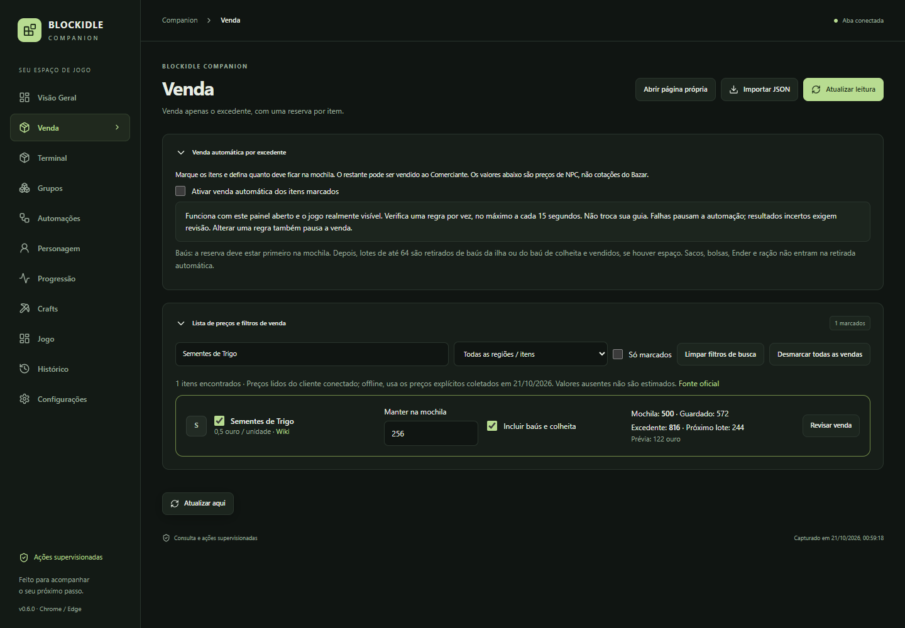

**Organize recursos, planeje crafts e acompanhe sua evolução em um só painel.**

[Baixar extensão](https://github.com/felippesantinifernandes-sketch/blockidle-companion/releases/latest) · [Como instalar](INSTALACAO.md) · [Novidades](CHANGELOG.md) · [Reportar problema](https://github.com/felippesantinifernandes-sketch/blockidle-companion/issues/new)

## O que você encontra

| Guia | Para que serve |
| --- | --- |
| Terminal | Busca unificada, localização e movimentação supervisionada dos materiais. |
| Venda | Preços de NPC, seleção por região, checkbox por item e reserva na mochila. |
| Automações | Modelos do compactador por região, filtros e transformações. |
| Crafts | Bancada ligada à wiki, materiais disponíveis/faltantes e objetivos encadeados. |
| Personagem | Coleção de acessórios, efeitos, famílias e próximos tiers. |
| Progressão | Coleções, habilidades e planejamento do nível SkyBlock. |
| Jogo | Página própria, janela do jogo e consulta ao ranking. |
| Configurações | Ordem das guias, tema, atualização e preferências locais. |

Todas as seções com título podem ser recolhidas pela seta. A escolha e a ordem das guias ficam salvas.

## Venda por excedente · 0.6

**Exemplo:** você tem 900 sementes, quer manter 256 e marca o item para venda. A prévia mostra 644 excedentes e 322 de ouro ao preço de NPC de 0,5 por unidade.

1. Abra **Venda**, escolha uma região ou busque o item.
2. Marque o checkbox e ajuste **Manter na mochila**.
3. Opcionalmente, habilite **Incluir baús e colheita**.
4. Revise uma venda manual ou ative a venda automática dos itens marcados.

A automação exige o painel aberto, estado recente e o jogo realmente visível. Não troca a guia em que você está. Processa uma regra por vez, no máximo a cada 15 segundos. Uma falha pausa as vendas; um resultado incerto bloqueia novas transações até revisão.

A reserva deve estar na mochila antes de vender de baús. A retirada usa lotes de até 64, após conferir espaço; não inclui ração, bolsas, sacos ou Ender. Editar regras pausa a automação. Favoritos, proteções, reservas locais e materiais de objetivos impedem a venda. A lista usa os preços do catálogo carregado no jogo; offline, mostra os valores explícitos coletados em 21/10/2026. Cada operação confere novamente o preço atual do cliente: não são cotações do Bazar e valores desconhecidos não são estimados.

## Instalar e atualizar

Baixe o ZIP da extensão em **Releases**, extraia em uma pasta permanente e use **Carregar sem compactação** em chrome://extensions ou edge://extensions, com o modo do desenvolvedor ativado. Selecione a pasta que contém manifest.json e recarregue o jogo.

**Já utiliza a extensão?** Atualize pela central em Configurações, selecionando a mesma pasta instalada. Também é possível substituir os arquivos nessa pasta e recarregar a extensão. Não desinstale: manter a mesma instalação preserva suas preferências. É possível atualizar diretamente da 0.4 para a 0.6; os novos campos recebem valores iniciais e a venda começa desativada.

[Instruções completas de instalação](INSTALACAO.md)

## Compatibilidade e privacidade

O build anterior `ef3c8efa9f` mantém as ações já validadas. O build `6b899075fb`, informado pelo usuário e comparado com os módulos públicos em 21/10/2026, tem suporte restrito a filtros do compactador e vendas. Cada operação relê estado, confere o build e valida o contrato nativo. Crafts e movimentações antigas nesse build aguardam revisão. Builds desconhecidos permanecem bloqueados.

Os testes usam clientes e respostas simulados. Não comprovam transações em uma conta real. O catálogo mantém lacunas e receitas antigas identificadas; o preço e as regras do servidor prevalecem.

Preferências e histórico ficam no navegador. O repositório e os pacotes não incluem diagnósticos de contas, autenticação ou inventários pessoais. Antes de abrir uma issue, remova informações pessoais e credenciais. O atualizador consulta este repositório público e confere a integridade do pacote.

Projeto independente, sem afiliação oficial com Blockidle ou Mojang. [Fontes e avisos de terceiros](THIRD_PARTY_NOTICES.md).

## Desenvolvimento

Requer Node.js 22. Instale as dependências com `npm ci`, compile com `npm run build` e rode os testes unitários com `npm test`. Para os testes de navegador, instale o Chromium do Playwright. `npm run release` executa a validação completa e gera os ZIPs e metadados.

- [Resultado dos testes](RESULTADO-DOS-TESTES.md)
- [Histórico de versões](CHANGELOG.md)
- [Evidências de compatibilidade](docs/compatibility-0.6.0.json)
